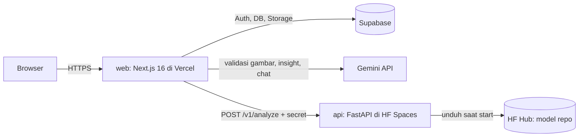

# Architecture

## 1. Gambaran



- **Browser tidak pernah memanggil API inferensi atau Gemini langsung.** Semua lewat Route Handler Next.js (BFF), yang memegang secret, memeriksa auth dan kuota, lalu meneruskan.
- **`api/` hanya urusan ML**: pre-filter gambar, deteksi, Grad-CAM. Tidak tahu soal user, kuota, atau Gemini.
- Alasan memisah: torch + ultralytics tidak muat di Vercel Functions, dan logika auth/kuota tetap satu bahasa (TS) seperti project lain pemilik.

## 2. Struktur repo

```text
web/                      Next.js 16 (App Router), TS strict, Tailwind v4
  src/app/                routing & Route Handlers (src/app/api/*)
  src/features/scan/      upload, viewer, daftar temuan, heatmap, class catalog
  src/features/insight/   prompt, stream, render insight
  src/features/chat/      panel chat, chat umum
  src/features/history/   riwayat
  src/features/auth/
  src/lib/                env (Zod), supabase (server/browser/admin), gemini, quota, i18n
  messages/id.json, en.json
api/                      FastAPI, Python 3.13
  app/main.py             endpoint
  app/model.py            load model dari HF Hub, inferensi
  app/gradcam.py          Grad-CAM per kelas
  app/prefilter.py        cek tipe/ukuran + decode upload, cek saturasi warna
  tests/
  Dockerfile              image untuk HF Spaces
supabase/
  migrations/*.sql
  tests/*.test.sql        pgTAP
docs/
.github/
```

## 3. API inferensi (`api/`)

### 3.1 Endpoint

| Method | Path | Auth | Fungsi |
|---|---|---|---|
| `GET` | `/health` | — | `{"status": "ready" \| "loading" \| "error", "model_version": "..."}`. `error` = model gagal dimuat (lihat log) |
| `POST` | `/v1/analyze` | Header `X-API-Secret` | Multipart `image` (JPEG/PNG ≤ 4 MB) → hasil |

Respons `/v1/analyze` (200):

```json
{
  "model_version": "yolov8m-resnet50@<sha256-8>",
  "image": { "width": 2048, "height": 1024 },
  "low_quality": false,
  "detections": [
    { "class_id": 0, "confidence": 0.81, "box": [0.12, 0.40, 0.16, 0.55] }
  ],
  "heatmaps": { "0": "<base64 PNG grayscale 8-bit>" },
  "timing_ms": { "prefilter": 12, "detect": 1400, "gradcam": 3100 }
}
```

- `box` = `[x1, y1, x2, y2]` dinormalisasi 0–1 terhadap gambar yang dikirim.
- `heatmaps` per `class_id` yang terdeteksi (≥ `conf` 0,25). PNG grayscale dengan rasio aspek gambar, sisi terpanjang 256 px. Pewarnaan (colormap) dilakukan di browser lewat canvas supaya mengikuti tema dan payload kecil.
- Nama, kelompok, dan teks kelas **tidak** dikirim API. Web memetakan `class_id` lewat class catalog ([class-catalog.md](class-catalog.md)).

Error:

| Status | `code` | Kapan |
|---|---|---|
| 401 | `unauthorized` | Secret salah |
| 411 | `length_required` | Request tanpa `Content-Length` (mis. chunked) |
| 413 | `too_large` | Body > 4 MB + 64 KB, gambar > 4 MB, atau > 25 juta piksel |
| 415 | `unsupported_type` | Bukan JPEG/PNG (dicek dari magic bytes) |
| 422 | `not_xray` | Pre-filter: > 15% piksel bersaturasi > 40 **dan** rata-rata saturasi > 20 (HSV, 0–255), pola yang sama dengan repo skripsi. Dicek sebelum model jalan |
| 503 | `busy` / `loading` / `model_unavailable` | Antrean > 60 dtk / model sedang dimuat / model gagal dimuat (`/health` = `error`, perlu restart) |

- Hasil tanpa deteksi tetap 200 dengan `detections: []`. Tidak ada aturan "harus ada kelas gigi": pada 31 panoramik contoh, model tidak pernah mendeteksi `Permanent Teeth`/`Primary teeth` (keputusan pengguna 2026-10-25, #6). Validasi utama "apakah ini X-ray gigi" ada di Gemini Vision (web, [ai-design.md §1](ai-design.md#1-validasi-x-ray-validate1)).
- Secret dan `Content-Length` dicek di middleware **sebelum** body dibaca, karena Starlette mem-parse dan men-spool seluruh multipart sebelum handler jalan. Urutan: 401 → 411 → 413.
- Decode memakai Pillow; gambar > 25 juta piksel ditolak `too_large` (perlindungan decompression bomb). File rusak di balik magic bytes yang valid ditolak `unsupported_type`.

### 3.2 Model

- Checkpoint `best_resnet50.pt` disimpan di model repo HF Hub publik [`adrielwalintukan/dentavision-yolov8m-resnet50`](https://huggingface.co/adrielwalintukan/dentavision-yolov8m-resnet50) (lisensi AGPL-3.0, mengikuti Ultralytics), dibaca dari `HF_MODEL_REPO` + `HF_MODEL_FILE`. Karena publik, `HF_TOKEN` tidak dibutuhkan. Diunduh sekali saat start lewat `huggingface_hub`, lalu di-cache.
- `ultralytics==8.4.161` di-pin, sama dengan versi training. Checkpoint memakai modul `TorchVision` + `Index` yang butuh versi ini.
- Inferensi: `imgsz=640`, `conf=0.10`, `iou=0.7`, device `cuda` bila ada, selain itu `cpu`.
- **Satu inferensi dalam satu waktu** (`asyncio.Lock`, 1 worker uvicorn). Ini antrean sederhana untuk CPU gratis.

### 3.3 Grad-CAM per kelas

1. Letterbox gambar ke 640 seperti preprocessing ultralytics, simpan padding.
2. Forward ulang `model.model` dengan grad aktif, ambil aktivasi + gradien dari layer target lewat hook. Default: output **SPPF** (sama dengan repo skripsi).
3. Untuk setiap kelas `c` yang terdeteksi: skor = jumlah logit kelas `c` pada anchor yang menjadi deteksi terpilih kelas `c`. `backward(retain_graph=True)`.
4. Bobot = rata-rata gradien per channel; CAM = ReLU(Σ bobot × aktivasi); normalisasi 0–1.
5. Buang padding letterbox, resize ke sisi terpanjang 256 px, encode PNG.

Spike M1: bandingkan SPPF (stride 32, kasar) dengan output neck P3 (stride 8, lebih tajam) pada 5 gambar. Pilihan final dicatat di sini.

### 3.4 Deploy

- HF Space tipe Docker, `api/Dockerfile`, port 7860. Secret Space: `API_SECRET` (`HF_TOKEN` hanya bila model repo dijadikan privat).
- Torch versi CPU (`--index-url https://download.pytorch.org/whl/cpu`) supaya image kecil.

## 4. Web (`web/`)

### 4.1 Route Handlers

| Method | Path | Fungsi |
|---|---|---|
| `POST` | `/api/scans` | Upload → kuota → validasi Gemini → `/v1/analyze` → (login & simpan) simpan. Respons: hasil + `scan_id` bila tersimpan |
| `GET` | `/api/samples/[key]` | Hasil contoh (cache statis, tanpa kuota) |
| `POST` | `/api/scans/import` | Simpan hasil tamu (US-10) |
| `DELETE` | `/api/scans/[id]` | Hapus scan + file Storage + chat terkait |
| `POST` | `/api/insight` | Stream insight untuk daftar temuan; bila `scan_id` ada, simpan hasil akhir |
| `POST` | `/api/chat` | Stream jawaban chat (per scan / umum) |
| `DELETE` | `/api/chats/[id]` | Hapus chat |
| `DELETE` | `/api/account` | Hapus akun + semua data |
| `GET` | `/api/health` | Teruskan status API inferensi (untuk state `waking`) |

Setiap handler: autentikasi (opsional untuk tamu) → otorisasi kepemilikan → validasi Zod → kuota → aksi.

### 4.2 Gambar

- Browser mengompres ke sisi terpanjang 2048 px, JPEG kualitas 0,9 (biasanya < 1 MB). Ini juga menjaga request di bawah batas body Vercel ±4,5 MB.
- Server memeriksa ulang: magic bytes, ukuran ≤ 4 MB, dimensi.

### 4.3 Gemini

- SDK `@google/genai`, modul `src/lib/gemini.ts` (`server-only`).
- Model dari env: `GEMINI_MODEL` (`gemini-3.5-flash-lite`), `GEMINI_FALLBACK_MODEL`. Pada 429 / `RESOURCE_EXHAUSTED`, coba model cadangan sekali.
- Prompt, skema, dan guardrail: [ai-design.md](ai-design.md).

### 4.4 i18n

File `messages/{id,en}.json` + helper `t()` kecil di `src/lib/i18n.ts`. Semua halaman ada di bawah segmen `app/[lang]/` (`/id/...`, `/en/...`), sesuai panduan i18n resmi Next.js 16. Dengan `cacheComponents`, pola ini membuat halaman tetap bisa di-prerender statis, dan `<html lang>` benar per bahasa.

`src/proxy.ts` mengarahkan URL tanpa prefix ke locale pilihan: cookie `locale`, lalu `Accept-Language`, lalu `id`. Toggle bahasa mengganti prefix URL dan menyimpan cookie.

## 5. Data model (Supabase)

```sql
profiles (
  id uuid pk references auth.users on delete cascade,
  display_name text,
  locale text check (locale in ('id','en')) default 'id',
  created_at timestamptz default now()
)

scans (
  id uuid pk default gen_random_uuid(),
  user_id uuid not null references auth.users on delete cascade,
  created_at timestamptz default now(),
  image_path text not null,          -- scans/{user_id}/{id}/original.jpg
  image_width int not null,
  image_height int not null,
  model_version text not null,
  detections jsonb not null,         -- array dari respons /v1/analyze
  heatmap_class_ids smallint[] not null,
  insight jsonb,                     -- output tervalidasi, lihat ai-design §3
  insight_locale text,
  insight_prompt_version text,
  source text not null check (source in ('upload','import'))
)

chats (
  id uuid pk default gen_random_uuid(),
  user_id uuid not null references auth.users on delete cascade,
  scan_id uuid references scans on delete cascade,  -- null = chat umum
  title text not null,
  created_at timestamptz default now(),
  updated_at timestamptz default now()
)

chat_messages (
  id bigint generated always as identity pk,
  chat_id uuid not null references chats on delete cascade,
  role text not null check (role in ('user','model')),
  content text not null check (length(content) <= 4000),
  created_at timestamptz default now()
)

usage_counters (
  subject text not null,             -- 'u:{user_id}' atau 'ip:{sha256(ip+salt)}'
  day date not null,                 -- tanggal WITA
  kind text not null check (kind in ('scan','chat')),
  count int not null default 0,
  primary key (subject, day, kind)
)
```

Fungsi `consume_quota(subject text, kind text, max int) returns boolean`: `insert ... on conflict do update set count = count + 1 where count < max`, atomik. `security definer`, hanya bisa dieksekusi `service_role`.

Trigger `on auth.users insert` → buat `profiles`.

### 5.1 RLS

| Tabel | select | insert | update | delete |
|---|---|---|---|---|
| `profiles` | pemilik | trigger | pemilik (kecuali `id`) | cascade |
| `scans` | pemilik | pemilik | ditolak (insight diisi service role) | pemilik |
| `chats` | pemilik | pemilik, `scan_id` milik sendiri | pemilik (`title`) | pemilik |
| `chat_messages` | pemilik chat | pemilik chat | ditolak | cascade |
| `usage_counters` | ditolak | ditolak | ditolak | ditolak |

### 5.2 Storage

- Bucket `scans`, **privat**. Path `{user_id}/{scan_id}/original.jpg` dan `{user_id}/{scan_id}/heatmap-{class_id}.png`.
- Policy: user hanya bisa membaca/menulis/menghapus objek dengan prefix `{auth.uid()}/`.
- Browser membaca lewat signed URL (berlaku 1 jam) dari server.
- Hapus scan/akun menghapus objek Storage lebih dulu, baru baris DB. Kalau hapus Storage gagal, baris DB tidak dihapus dan user mendapat error.

## 6. Environment

### `web/.env.local`

| Variabel | Server only | Contoh |
|---|---|---|
| `NEXT_PUBLIC_SUPABASE_URL` | — | `https://xxx.supabase.co` |
| `NEXT_PUBLIC_SUPABASE_ANON_KEY` | — | |
| `SUPABASE_SERVICE_ROLE_KEY` | ✅ | |
| `GEMINI_API_KEY` | ✅ | |
| `GEMINI_MODEL` | ✅ | `gemini-3.5-flash-lite` |
| `GEMINI_FALLBACK_MODEL` | ✅ | ditentukan di M3 setelah cek dokumentasi resmi |
| `INFERENCE_API_URL` | ✅ | `https://<space>.hf.space` |
| `INFERENCE_API_SECRET` | ✅ | |
| `IP_HASH_SALT` | ✅ | |
| `QUOTA_GUEST_SCANS`, `QUOTA_GUEST_CHATS`, `QUOTA_USER_SCANS`, `QUOTA_USER_CHATS` | ✅ | `5`, `20`, `20`, `100` |

Divalidasi lazy di `src/lib/env.ts` (Zod) supaya `next build` di CI tidak butuh secret.

### `api/.env`

| Variabel | Contoh |
|---|---|
| `API_SECRET` | sama dengan `INFERENCE_API_SECRET` |
| `HF_MODEL_REPO` | `adrielwalintukan/dentavision-yolov8m-resnet50` (juga repo variable GitHub Actions) |
| `HF_MODEL_FILE` | `best_resnet50.pt` |
| `HF_TOKEN` | tidak perlu selama model repo publik |
| `MODEL_PATH` | opsional: path lokal, melewati HF Hub (dev) |

## 7. Pengujian

| Lapisan | Alat | Contoh |
|---|---|---|
| Web unit | Vitest | Pemetaan `class_id` → kelompok, kuadran kasar dari `box`, parser output insight, kompres gambar |
| Web route | Vitest + mock `fetch` | 429 Gemini → fallback model; API inferensi 503 → error `busy`; tamu tidak bisa `DELETE /api/scans/[id]` |
| API unit | pytest + model palsu | Validasi tipe/ukuran, mapping box, Grad-CAM menghasilkan PNG per kelas, padding letterbox dibuang |
| Model smoke | pytest + checkpoint asli | Load dari HF Hub, 1 inferensi + Grad-CAM di gambar fixture, waktu < 60 dtk di runner CI |
| Database | pgTAP | RLS per tabel, `consume_quota` atomik dan tidak bisa dipanggil `anon`/`authenticated`, cascade hapus akun |
| E2E | Playwright (fase setelah M4) | Contoh → hasil → chat di viewport HP |
