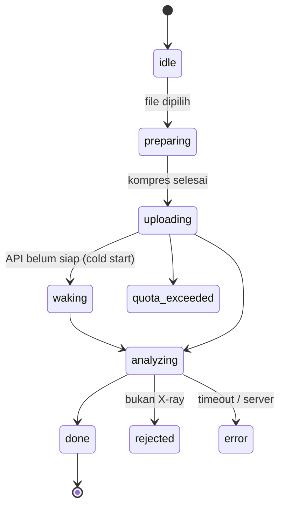
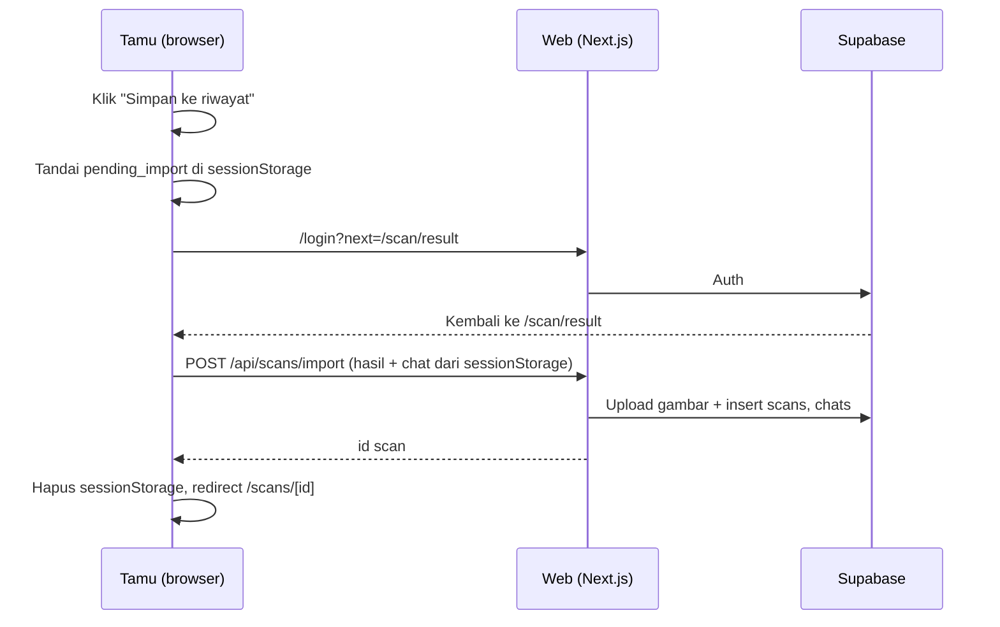

# User Flows

## 1. Rute & layar

| Rute | Layar | Akses | Area visual |
|---|---|---|---|
| `/` | Landing | Publik | Terang |
| `/scan` | Upload + pilih contoh | Publik | Terang |
| `/scan/result` | Hasil scan tamu / scan baru (data dari `sessionStorage`) | Publik | Gelap |
| `/scans/[id]` | Hasil scan tersimpan | Pemilik | Gelap |
| `/chat` | Chat umum baru | Publik | Terang |
| `/chats/[id]` | Chat tersimpan (umum atau per scan) | Pemilik | Terang |
| `/history` | Riwayat scan & chat (tab) | Login | Terang |
| `/login`, `/register`, `/reset-password` | Auth | Publik | Terang |
| `/auth/callback` | Callback OAuth / verifikasi email | Publik | — |
| `/settings` | Bahasa, hapus akun | Login | Terang |
| `/privacy`, `/about-model` | Transparansi | Publik | Terang |

Area "Gelap" = workspace viewer ([design-system.md §1](design-system.md#1-konsep)).

## 2. Alur scan

```mermaid
flowchart TD
  A[/scan] --> B{Pilih}
  B -->|Upload| C[Cek tipe & ukuran di browser]
  B -->|Contoh| S[Ambil hasil contoh dari cache] --> R
  C -->|Gagal| C1[Pesan error di dropzone]
  C -->|OK| D[Kompres ke 2048 px JPEG]
  D --> E[POST /api/scans]
  E --> F{Kuota}
  F -->|Habis| F1[Layar kuota habis]
  F -->|OK| G{Validasi X-ray}
  G -->|Bukan X-ray gigi| G1[Pesan + contoh gambar yang benar]
  G -->|OK| H[Inferensi + Grad-CAM di API]
  H -->|Timeout / sibuk| H1[Pesan + coba lagi]
  H --> I{Login & simpan?}
  I -->|Ya| J[Simpan ke Storage + tabel scans] --> R2[/scans/id]
  I -->|Tidak| K[Simpan di sessionStorage] --> R[/scan/result]
  R --> L[Insight streaming]
  R2 --> L
```

## 3. State scan di browser



- `waking` ditampilkan bila `/api/health` API belum menjawab "ready" dalam 3 detik. Copy: "Menyiapkan server, biasanya kurang dari 1 menit".
- Langkah di layar `analyzing` mengikuti tahap nyata (validasi → deteksi → heatmap), bukan progress bar palsu.

## 4. Simpan hasil tamu (US-10)



Kalau tab ditutup sebelum login selesai, data tamu hilang. Ini sesuai aturan privasi.

## 5. Alur chat

- **Per scan**: panel di halaman hasil (desktop: kolom kanan; HP: bottom sheet). Untuk pengguna login, chat dibuat di DB saat pesan pertama dikirim, terhubung ke `scan_id`.
- **Umum**: `/chat`. Pesan pertama pengguna login membuat chat baru lalu URL berganti ke `/chats/[id]`.
- **Tamu**: riwayat pesan disimpan di `sessionStorage` dan dikirim ulang ke server setiap giliran (maks 20 pesan).

## 6. Kasus khusus

| Kasus | Perilaku |
|---|---|
| Gambar portrait / sangat kecil (< 800 px lebar) | Tetap diproses, dengan peringatan "kualitas gambar rendah" |
| Tidak ada temuan sama sekali | Layar hasil tetap tampil + pesan keterbatasan model |
| Gemini 429 di semua model | Validasi jatuh ke pre-filter; insight/chat menampilkan pesan tidak tersedia |
| Pengguna login menghapus scan yang sedang dibuka di tab lain | Tab lain menampilkan "Scan ini sudah dihapus" |
| Ganti bahasa di tengah halaman hasil | UI berganti; insight yang sudah ada tetap, tombol "Buat ulang dalam English" |
